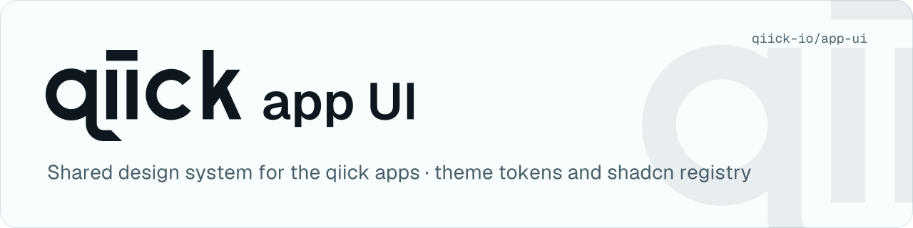

<p align="center">
  <picture>
    <source media="(prefers-color-scheme: dark)" srcset=".github/assets/header-dark.svg">
    <source media="(prefers-color-scheme: light)" srcset=".github/assets/header-light.svg">
    
  </picture>
</p>

# qiick app UI

Shared admin UI for the open-source, installable [qiick](https://qiick.io) apps: [Externa](https://github.com/qiick-io/externa-core), [Excubia](https://github.com/qiick-io/excubia-app), and the apps that follow.

> **Status:** early development. Nothing is published yet.

## For agents and contributors

Before any UI change in a qiick app, read [`AGENTS.md`](AGENTS.md) (the hard rules) and [`docs/`](docs/README.md) (one page per pattern, pointing at the exact externa-core files). Apps copy [`docs/app-agents-section.md`](docs/app-agents-section.md) into their own `AGENTS.md` / `CLAUDE.md`. Releases: [`RELEASING.md`](RELEASING.md).

## What it is

Two parts, so that every app looks the same while staying fully customizable:

- **`@qiick/theme`** is the theme as a registry item: one CSS file with the design tokens (colours with a per-product brand preset, the control size scale `sm` 24px / default 32px / `lg` 40px, focus-ring and contrast rules, the AI accent tokens). It is copied into the app like the components, so there is no npm dependency, one version covers tokens and components, and the drift check covers the theme too. Apps can override any variable.
- **A [shadcn](https://ui.shadcn.com) component registry** holds the components: button, input, select, segmented control, sidebar, page header, toolbar, empty state and the `cn` helper. Apps install them with `npx shadcn add @qiick/<name>`, so the code lives in the app and can be changed freely.

Each app's CI checks its components against the registry. Intentional overrides are listed in the app, so differences stay visible instead of drifting silently.

## Using it in an app

Add the registry to the app's `components.json`, pinned to a release tag (#4):

```json
"registries": {
    "@qiick": "https://raw.githubusercontent.com/qiick-io/app-ui/vX.Y.Z/public/r/{name}.json"
}
```

Then install items with `npx shadcn add @qiick/<name>`. To upgrade, change the tag and run `shadcn add` again.

## Drift check

Each app's CI checks that its copies of the registry files still match the pinned tag:

```yaml
jobs:
    app-ui-drift:
        uses: qiick-io/app-ui/.github/workflows/drift-check.yml@vX.Y.Z
```

The workflow reads the tag from `components.json` and runs [`scripts/check-drift.mjs`](scripts/check-drift.mjs) from that tag. An item counts as installed when any of its files is in the app; every file of an installed item must match the registry, or be listed with a reason in `app-ui.overrides.json` at the app root:

```json
{
    "resources/js/components/ui/button.tsx": "Pill radius, part of the product brand"
}
```

A difference without an entry fails and prints the diff and the registry version; an entry whose file matches again also fails, so overrides do not outlive their reason. Locally, from the app root:

```bash
curl -fsSL https://raw.githubusercontent.com/qiick-io/app-ui/vX.Y.Z/scripts/check-drift.mjs -o /tmp/check-drift.mjs && node /tmp/check-drift.mjs
```

## Repository layout

| Path         | What                                                                       |
| ------------ | -------------------------------------------------------------------------- |
| `registry`   | Registry sources (`src/`, same `@/` paths as the apps) and `registry.json` |
| `public/r`   | `shadcn build` output, committed: apps install from these files            |
| `playground` | Vite + React page that renders every item in light and dark mode           |

## Development

Node 24 (`.nvmrc`).

```bash
npm install
npm run dev        # playground on http://localhost:5173
npm run build      # theme dist, public/r, playground
npm run registry:check
```

Commit `public/r` together with the registry sources: CI fails when it is stale. Commits and PR titles follow [Conventional Commits](https://www.conventionalcommits.org). Work goes into `develop`; releases go `develop` → `main` and are tagged by a maintainer.

## Not in scope

The qiick websites. They are built on licensed Tailwind Plus templates, which cannot be redistributed, and they are not part of this repo.

## License

MIT
